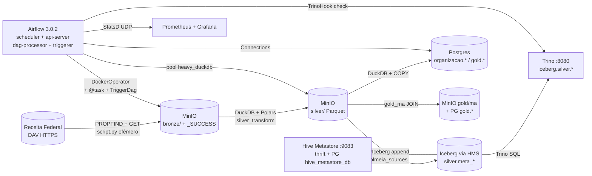
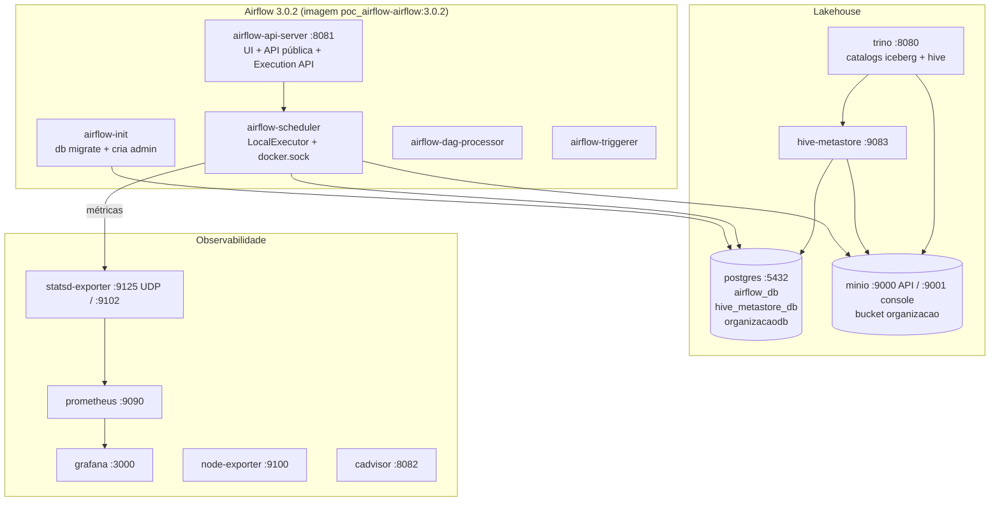
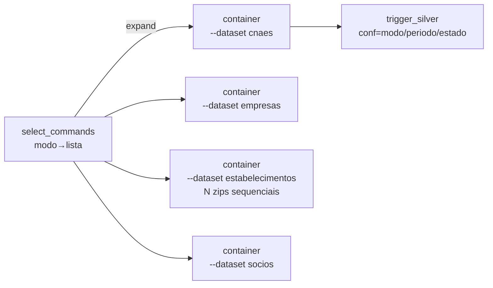

# POC Airflow Kolmeia — Lakehouse local com Airflow 3, Trino, Iceberg e MinIO

> Pipeline fim a fim de dados públicos da **Receita Federal (EmpresasBR/CNPJs)** orquestrado por **Apache Airflow 3.0.2**, com camadas **Bronze → Silver → Postgres → Gold**, catálogo **Hive + Iceberg**, engine **Trino**, lago **MinIO** e observabilidade **Prometheus + Grafana**.
>
>     

---

## 0. Para quem é este README — mapa de leitura

Este README foi escrito para três níveis. Você não precisa ler tudo de uma vez.

| Nível | Quem é você | O que ler | Tempo |
|---|---|---|---|
| 🟢 **Iniciante (newbie)** | Nunca usou Airflow/Docker. Só quer subir e ver funcionando. | Seções 1, 2, 3, 4, 5, 11, 13 | ~15 min + 20 min de setup |
| 🟡 **Intermediário** | Já usa Docker/Python/SQL. Quer entender o pipeline, rodar smoke/full, mexer nas DAGs. | Tudo acima + Seções 6, 7, 8, 9, 12 | ~1 hora |
| 🔴 **Expert** | Quer operar, dar hardening, entender RBAC a fundo, debugar Iceberg/Trino/JWT, levar para produção. | Tudo + Seções 10, 14, 15, 16, 17 | ~2 horas + prática |

> ⚠️ **Sobre senhas neste README:** mantemos as credenciais **default locais** (`admin/admin`, `minioadmin/minioadmin123`, `kolmeia_*123`) de propósito, para fins didáticos. Elas **só valem para ambiente local**. Troque no primeiro uso real. Veja Seção 10. Nunca commite o arquivo `.env` real — ele está no `.gitignore`.

---

## 1. 🟢 O que é este projeto, em português simples

Imagine uma fábrica com 4 esteiras:

1. **Bronze (caminhão descarregando):** baixa arquivos ZIP brutos da Receita Federal (site oficial `arquivos.receitafederal.gov.br`) e joga no "galpão" (MinIO, pasta `bronze/`).
2. **Silver (limpeza e separação):** abre os ZIPs, converte CSV `;` separado e codificado em `ISO-8859-1` para Parquet comprimido, valida linhas e separa por UF. Salva em `silver/` e registra no catálogo Iceberg.
3. **Postgres (estoque organizado):** carrega o Parquet limpo para o banco `organizacaodb` (`organizacao.cnaes`, `organizacao.dados_empresas`).
4. **Gold (vitrine):** monta a tabela final agregada do Maranhão (`gold/ma` + `gold.empresas_ma`) e valida que o Trino enxerga tudo.

Quem manda em tudo é o **Airflow**: ele agenda, executa, tenta de novo se falhar, isola projetos por usuário (RBAC) e encadeia as 4 esteiras automaticamente via `TriggerDagRunOperator`.

**Prova real já executada (smoke, 2026-09):**

```sql
SELECT count(*) FROM iceberg.silver.meta_cnaes;  -- 1359
SELECT periodo, count(*) FROM organizacao.cnaes GROUP BY 1;  -- 2026-09, 1359
```

Ou seja: 1.359 CNAEs (códigos de atividade econômica) do Maranhão, idênticos no lago e no banco.

**O que este projeto NÃO é (para alinhar expectativa):**

- Não é produção em nuvem. É **local via Docker Compose**, validado em máquina com **32 GB RAM**.
- Modo `smoke` (pequeno: só `cnaes/MA`) está pronto e medido. Modo `full` validado para **1 UF (MA) em 2026-10-10** fim a fim (silver 1.1GB empresas + 518MB socios + splits MA → `dados_empresas` 1.089.670 linhas MA + `gold.empresas_ma` 1.056.100). Full **27 UFs** segue pesado (multi-GB por UF, exige tempo/disco; rode fatiado e com `pool heavy_duckdb=1`).
- No smoke, o processamento pesado é **DuckDB local (2 GB / 2 threads)** dentro do worker. O Trino **lê e valida** o resultado via Iceberg. Não é "Trino processa tudo" no smoke.

Documentos de origem do plano (contexto histórico, parcialmente desatualizado): `plano_de_trabalho_consolidado.md` e `docs_roteiro_videos.md`. O roteiro de vídeos **não está embutido aqui** — veja link na Seção 12.

---

## 2. 🟢🟡🔴 Arquitetura — visão geral

### 2.1 Diagrama Mermaid (fluxo de dados)



### 2.2 Diagrama Mermaid (serviços e portas)



### 2.3 Tabela de serviços (o que é, onde fala, para que serve)

| Serviço (compose) | URL interna | URL no host | Uso real neste projeto |
|---|---|---|---|
| `airflow-api-server` | `http://airflow-api-server:8081` | http://localhost:8081 | UI, `/api/v2/*`, `/openapi.json`. **Execution API** fica em `http://airflow-api-server:8081/execution/` (só intra-rede, tasks → scheduler). |
| Scheduler log server | `localhost:8793` no container | — | **NÃO é** a Execution API. Confundir custou 1h de debug (ver Seção 10). |
| `postgres` | `postgres:5432` | :5432 | 3 bancos na mesma instância PG15: `airflow_db` (metadata Airflow), `hive_metastore_db` (catálogo), `organizacaodb` (dados finais `organizacao.*`, `gold.*`). Criados por `postgres-init/01-init-dbs.sh`. |
| `minio` | `http://minio:9000` / `:9001` | :9000 / :9001 | Lago S3-local. Bucket `organizacao` com prefixos `bronze/`, `silver/`, `gold/`, `warehouse/` (Iceberg). Console em :9001. |
| `hive-metastore` | `thrift://hive-metastore:9083` | :9083 | Catálogo Iceberg (PyIceberg + Trino). Usa `metastore-site.xml` + `HADOOP_CLASSPATH` com S3A. |
| `trino` | `http://trino:8080` | :8080 | Lê `iceberg.*` + `hive.*` via `config/trino/catalog/*.properties` (S3 nativo). Validação smoke: `iceberg.silver.meta_cnaes`. |
| `prometheus` / statsd-exporter / node / cAdvisor | `prometheus:9090`, `:9102`, `:9100`, `:8080` | :9090 / :9102 / :9100 / :8082 | Métricas `up{}`, `airflow_*`, `container_*`, `node_*`. MinIO exige `bearer_token` rotacionado pelo bootstrap. |
| `grafana` | `http://grafana:3000` | :3000 | Dashboard `Kolmeia SRE — Pipelines` (uid `kolmeia-sre`). Provisionado em `config/grafana/provisioning/`. |
| Receita Federal DAV | `https://arquivos.receitafederal.gov.br/.../YggdBLfdninEJX9/YYYY-MM/` | — | Fonte oficial. Discovery via `PROPFIND` + `HEAD/GET` com fallback de 6 meses. |

Limites de memória no compose (somam ~23 GB + overhead — por isso 32 GB): Trino 6g, scheduler 8g (era 4g; LocalExecutor roda tasks dentro do scheduler e o full-mode OOMkillava — 2026-10-10), postgres/minio/hive/api/dag-processor 2g cada, triggerer/prom/grafana 1g cada, cAdvisor 512m.

Rede fixa: `networks.default.name=kolmeia-net`. A DAG Bronze usa `network_mode="kolmeia-net"` para o container efêmero enxergar o MinIO. Sem nome fixo, o prefixo do projeto muda por máquina e quebra.

---

## 3. 🟢 Pré-requisitos (não pule)

1. **SO:** Linux (validado). WSL2 funciona se o Docker estiver no Linux.
2. **Docker + plugin compose:**
   ```bash
   docker --version
   docker compose version
   ```
3. **Python 3.11+** (só para gerar segredos no bootstrap e rodar `make gates` fora do Docker).
4. **RAM:** 32 GB recomendado. Com 16 GB, suba só o núcleo (`make up` — ver Seção 5) e feche o resto.
5. **Portas livres:** 3000, 5432, 8080, 8081, 8082, 9000, 9001, 9090, 9100, 9102. Cheque com `ss -tlnp | grep -E '8081|9000|5432'`.
6. **Acesso ao docker.sock:** o scheduler monta `/var/run/docker.sock` para fazer Docker-out-of-Docker (sobe o container de ingestão). O bootstrap ajusta `DOCKER_GID` automaticamente.
7. **Internet:** para baixar imagens (Airflow 3.0.2, Trino 455, Hive 4.0, PG15, MinIO) e os ZIPs da RF na primeira execução.

---

## 4. 🟢 Quickstart passo a passo (copie e cole)

> Tempo estimado: build 5-10 min (primeira vez) + subida 3-5 min.

### Passo 0 — Clonar e entrar na pasta

```bash
git clone <url-do-repo> poc_airflow
cd poc_airflow
ls
# deve mostrar: dags/ include/ docker-compose.yml Makefile scripts/ .env.example ...
```

### Passo 1 — Criar o `.env` (nunca commite o real)

```bash
cp .env.example .env
# ou deixe o bootstrap fazer isso por você (recomendado)
```

O `.env.example` já traz os defaults locais:

- Airflow: `LocalExecutor`, `FabAuthManager` (RBAC por DAG), `EXECUTION_API_SERVER_URL=http://airflow-api-server:8081/execution/`, StatsD ligado.
- Postgres: `airflow/airflow`, `hive/hive`, `organizacao_user/organizacao_password`.
- MinIO: `minioadmin/minioadmin123`, bucket `organizacao`.
- Processamento: `PROCESSING_ESTADO=MA`, `MAGE_TEMP_DIR=/tmp/mage`, `DUCKDB_MEMORY_LIMIT_GB=2.0`.

### Passo 2 — Bootstrap zero-touch (recomendado)

```bash
./scripts/bootstrap.sh
# Para recomeçar do zero APAGANDO volumes (PERDE DADOS):
# ./scripts/bootstrap.sh --reset
```

O que ele faz, em ordem (ver `scripts/bootstrap.sh`):

```
[0] checa docker + compose
[1] cria .env se faltar; gera JWT_SECRET, FERNET_KEY e DOCKER_GID
[2] build poc_airflow-airflow:3.0.2 (Dockerfile.airflow) + poc_airflow-ingestao_rf:latest
[3] docker compose up -d; espera postgres/minio healthy + airflow-init exit 0
[4] secrets backend (gera `config/airflow/*.json` do `.env`, limpa legados do DB), pool heavy_duckdb=1 (serializado; era 2 — OOM no full-mode 2026-10-10)
[5] aplica RBAC (rbac_kolmeia.sh dentro do scheduler)
[6] despausa as 5 DAGs
[7] rotaciona token MinIO p/ Prometheus
== BOOTSTRAP-OK ==
```

Ao final ele imprime:

```
UI:      http://localhost:8081 (admin/admin)
MinIO:   http://localhost:9001 | Trino: http://localhost:8080
Grafana: http://localhost:3000 | Prometheus: http://localhost:9090
```

### Passo 3 — Conferir saúde

```bash
docker compose ps
# postgres e minio devem estar healthy; airflow-init exited 0
docker compose logs -f --tail=100
# ou: make logs
```

### Passo 4 — Rodar gates (qualidade, sem infra)

```bash
make gates
# = make lint + typecheck + test
# lint: ruff + black --check + flake8 + vulture
# typecheck: mypy include (strict)
# test: pytest tests -q (7 testes, stores fake, sem MinIO/PG)
```

Esperado: tudo verde.

### Passo 5 — Rodar o smoke (ponta a ponta, pequeno)

Opção A — pela UI: http://localhost:8081 (login `admin` / `admin`) → DAG `silver_zip_to_parquet` → Trigger → Conf `{"modo":"smoke","periodo":"","estado":"MA"}`.

Opção B — pelo CLI:

```bash
docker compose exec airflow-scheduler airflow dags trigger silver_zip_to_parquet --conf '{"modo":"smoke","periodo":"","estado":"MA"}'
```

Depois encadeie manualmente (o encadeamento automático via `TriggerDagRunOperator` também existe — ver Seção 6):

```bash
docker compose exec airflow-scheduler airflow dags trigger postgres_carga --conf '{"modo":"smoke","periodo":"","estado":"MA"}'
docker compose exec airflow-scheduler airflow dags trigger gold_marts --conf '{"modo":"smoke","periodo":"","estado":"MA"}'
```

Ou rode só o Bronze primeiro (baixa da RF de verdade):

```bash
docker compose exec airflow-scheduler airflow dags trigger bronze_rf_to_minio --conf '{"modo":"smoke","periodo":"","estado":"MA"}'
```

Validação esperada no `gold_marts.check_silver_meta`: `meta_cnaes_rows = 1359`.

### Passo 6 — Ver o resultado

- MinIO console http://localhost:9001 (login `minioadmin` / `minioadmin123`): bucket `organizacao` → `bronze/cnaes/`, `silver/cnaes/`, `_control/_SUCCESS_*`.
- Trino http://localhost:8080: rode `SELECT count(*) FROM iceberg.silver.meta_cnaes`.
- Postgres:
  ```bash
  docker compose exec -T postgres psql -U organizacao_user -d organizacaodb -c "SELECT periodo, count(*) FROM organizacao.cnaes GROUP BY 1;"
  ```

### Passo 7 — Desligar

```bash
docker compose down
# com volumes (apaga tudo): docker compose down -v
```

---

## 5. 🟢 Comandos do dia a dia (`Makefile` + Docker)

| Comando | O que faz | Quando usar |
|---|---|---|
| `make up` | `compose up -d --build postgres minio minio-init` (só núcleo) | Máquina fraca ou debug do lago |
| `make up-full` (definido como `up-full:` no Makefile, sem PHONY) / `docker compose up -d --build` | Sobe tudo | Uso normal |
| `make down` / `make logs` | Desce / segue logs | Operação |
| `make gates` | `lint + typecheck + test` | Antes de cada commit |
| `make lint` | ruff + black --check + flake8 (110 cols) + vulture | Estilo e código morto |
| `make typecheck` | `mypy include` (strict) | Tipos |
| `make test` | `pytest tests -q` | DAG integrity + unidade |
| `make build-ingestao` | Build da imagem de ingestão | Após mexer em `docker/ingestao_rf/` |
| `make smoke-ma` | Build + `script.py --dataset cnaes --estado MA` local | Testar ingestão sem Airflow |
| `make rbac-verify` / `./scripts/rbac_verify.sh` | Checa matriz 5 DAGs × 3 roles no PG | Após mexer em RBAC |
| `make bootstrap` / `./scripts/bootstrap.sh` | Zero-touch completo | Primeira vez / reset |
| `make login-proof` / `./scripts/login_proof.sh` | 9 checks HTTP reais com JWT | Provar RBAC por login |

---

## 6. 🟡 Pipeline de dados — as 5 DAGs em detalhe

Todas ficam em `dags/` e usam `params={"modo":"smoke","periodo":"","estado":"MA"}`. `schedule=None`, `catchup=False` (só manual ou via trigger).

```
bronze_rf_to_minio ──TriggerDagRun──▶ silver_zip_to_parquet ──▶ postgres_carga ──▶ gold_marts
                                                    financeiro_dummy (isolada, só p/ RBAC)
```

### 6.0 Run parameters — tabela única + fichas por DAG (🟢🟡🔴)

Todas as 4 DAGs de dados declaram o mesmo `params` (`dags/*.py:20`), mas o **efeito muda por DAG**. A `financeiro_dummy` não tem `params`.

#### Tabela única compacta

| Param | Tipo / valores | Default | Validação (`include/kolmeia/config.py`) | O que significa |
|---|---|---|---|---|
| `modo` | `"smoke"` \| `"full"` | `"smoke"` | `RunParams.from_dag_params`; outro valor → `ValueError: modo inválido` | `smoke` trava slice mínimo (`datasets=("cnaes",)`, `ufs=("MA",)`, ignora `estado`). `full` expande (`datasets=4`, `ufs=resolve_ufs(...)`). |
| `periodo` | `""` \| `"YYYY-MM"` (ex. `"2026-09"`) | `""` | `validate_periodo` regex `\d{4}-\d{2}`; `"09-2026"` → `ValueError` | `""` **não é mês atual**: é `resolve_periodo_or_latest` — último mês com marker `_SUCCESS` (até 6 meses p/ trás). Explícito exige marker existente, senão `ValueError: Bronze sem _SUCCESS`. |
| `estado` | `""` \| `"MA"` \| `"MA,SP"` \| lista das 27 UFs (separadores `,;|`) | `"MA"` | Validado contra `DEFAULT_UFS_BRASIL` (27 UFs); `"XX"` → `ValueError: UFs inválidas` | Só tem efeito em `modo=full` (smoke ignora e fixa `MA`). Prioridade: `params.estado` > env `PROCESSING_ESTADO` > todas as 27 UFs. |

Exemplo de `--conf` (colar no trigger):

```bash
# smoke (padrão, validado 1359 linhas)
--conf '{"modo":"smoke","periodo":"","estado":"MA"}'
# full recorte (2 UFs, 1 período fixo)
--conf '{"modo":"full","periodo":"2026-09","estado":"MA,SP"}'
# full TODAS as UFs (exemplo com todas, multi-GB — veja aviso abaixo)
--conf '{"modo":"full","periodo":"2026-09","estado":"AC,AL,AP,AM,BA,CE,DF,ES,GO,MA,MT,MS,MG,PA,PB,PR,PE,PI,RJ,RN,RS,RO,RR,SC,SP,SE,TO"}'
```

> ⚠️ **Full todas as UFs = roadmap pesado.** Baixa dezenas de GB da RF (`Estabelecimentos0..9.zip`, `Socios*.zip`), exige disco/RAM/rede e demora horas. Com `periodo:""` ele resolve o latest com `_SUCCESS` em vez de fixar mês. Com `estado:""` ele **não** vai direto para todas: cai no env `PROCESSING_ESTADO` (default `MA` no `.env.example`); só dá todas se o env também estiver vazio. Por isso o exemplo acima lista as 27 explicitamente — é a forma determinística.

#### Envs que afetam os params (fallback)

| Env (`.env` / `.env.example`) | Default local | Quando entra |
|---|---|---|
| `PROCESSING_PERIODO` | `""` (vazio) | Se `params.periodo` vazio: usa o env se preenchido, senão latest `_SUCCESS`. |
| `PROCESSING_ESTADO` | `MA` | Se `params.estado` vazio: usa o env se preenchido, senão todas as 27 UFs. É por isso que `estado:""` sozinho ainda dá `MA` no setup padrão. |
| `UFS_BRASIL` | `MA` | Documental / paridade Mage; a resolução real usa `PROCESSING_ESTADO`. |
| `MAGE_TEMP_DIR` | `/tmp/mage` | Temp do download/transform (volume `mage-tmp`). Não é param de DAG, mas afeta disco. |
| `TMPDIR` (só scheduler) | `/tmp/mage` | Todo `tempfile` das tasks vai para o volume em disco; o `/tmp` do host é tmpfs 16GB e lotou no full-mode (Errno 28 em 2026-10-10). |
| `DUCKDB_MEMORY_LIMIT_GB` / `DUCKDB_THREADS` | `2.0` / `2` | Documental; o código fixa `SET memory_limit='2GB'` + `threads=2` por conexão em `silver.py`/`gold.py`. |

#### Ficha 1/5 — `bronze_rf_to_minio` (1 container por dataset, não por arquivo)

- **Params aceitos:** `modo, periodo, estado` (todos repassados ao container).
- **Smoke:** `select_commands` → `["--dataset cnaes --estado MA"]` → **1 container**.
- **Full:** 4 comandos (`cnaes, empresas, estabelecimentos, socios`) → **4 containers** via `DockerOperator.partial().expand(command=chosen)`, `max_active_tasks=4`, `pool heavy_duckdb` (1 slot → tasks pesadas serializadas; OOM com 2 no full-mode 2026-10-10).
- **O que cada container faz:** `script.py --dataset X [--periodo Y]` → `PROPFIND` + fallback 6 meses → baixa **N zips do dataset em loop sequencial** (ex. `Cnaes.zip` único vs `Estabelecimentos0..9.zip`) → upload `bronze/<ds>/*.zip` + marker `bronze/<ds>/_control/_SUCCESS_<YYYYMMDD>`. Se marker existe → `skip` (exit 0).
- **Pegadinha `estado`:** repassado como `--estado` mas **ignorado para filtro** (bronze baixa tudo; filtro UF é só no silver).
- **Trigger:**
  ```bash
  docker compose exec airflow-scheduler airflow dags trigger bronze_rf_to_minio --conf '{"modo":"smoke","periodo":"","estado":"MA"}'
  docker compose exec airflow-scheduler airflow dags trigger bronze_rf_to_minio --conf '{"modo":"full","periodo":"2026-09","estado":"AC,AL,AP,AM,BA,CE,DF,ES,GO,MA,MT,MS,MG,PA,PB,PR,PE,PI,RJ,RN,RS,RO,RR,SC,SP,SE,TO"}'
  ```



> Por que não 1-arquivo-por-container? Overhead de subir container Docker por arquivo + limite da RF + idempotência por dataset (`_SUCCESS` por dataset) é mais simples e já paraleliza o suficiente. O gargalo real é `estabelecimentos` (multi-GB), não a quantidade de containers.

#### Ficha 2/5 — `silver_zip_to_parquet`

- **Params aceitos:** `modo, periodo, estado`.
- **Smoke:** `select_datasets` → `["cnaes"]` → `silver_one.expand(dataset)` = 1 task. `run.ufs=("MA",)` resolvido mas **ignorado** (só `estabelecimentos` usa UFs).
- **Full todas as UFs:** 4 tasks (`cnaes, empresas, estabelecimentos, socios`); `estabelecimentos` faz `split_by_uf` → 27 Parquets (`estabelecimentos_MA_*.parquet`, ...).
- **Como resolve `periodo`:** `run.periodo or resolve_periodo_or_latest(... bronze/<dataset> ...)` — **por dataset**. Depois `suffix=get_last_day_of_month(periodo)`. Se `silver/<ds>/_SUCCESS_<suffix>` existe → retorna `{"skipped":true}`.
- **Saída:** `silver/<ds>/*_<YYYYMMDD>.parquet` + `iceberg.silver.meta_<ds>` + marker silver.
- **Trigger:**
  ```bash
  docker compose exec airflow-scheduler airflow dags trigger silver_zip_to_parquet --conf '{"modo":"smoke","periodo":"","estado":"MA"}'
  docker compose exec airflow-scheduler airflow dags trigger silver_zip_to_parquet --conf '{"modo":"full","periodo":"2026-09","estado":"AC,AL,AP,AM,BA,CE,DF,ES,GO,MA,MT,MS,MG,PA,PB,PR,PE,PI,RJ,RN,RS,RO,RR,SC,SP,SE,TO"}'
  ```

#### Ficha 3/5 — `postgres_carga`

- **Params aceitos:** `modo, periodo, estado`.
- **Smoke:** `select_ufs` → `[]` → `load_dados_empresas.expand` gera **0 tasks** (pula `dados_empresas`, só `load_cnaes` roda). É o comportamento esperado, não erro.
- **Full todas as UFs:** `select_ufs` → 27 UFs → `load_dados_empresas.expand(uf)` = 27 tasks após `load_cnaes`.
- **Como resolve `periodo`:** `load_cnaes` checa `silver/cnaes`; `load_dados_empresas` checa `silver/estabelecimentos`. Sem Parquet com o `suffix` → `ValueError: sem silver ... para <periodo>`.
- **Idempotência PG:** `TRUNCATE organizacao.cnaes` (cnaes) e `DELETE WHERE uf+periodo` (`dados_empresas`, 17 colunas).
- **Trigger:**
  ```bash
  docker compose exec airflow-scheduler airflow dags trigger postgres_carga --conf '{"modo":"smoke","periodo":"","estado":"MA"}'
  docker compose exec airflow-scheduler airflow dags trigger postgres_carga --conf '{"modo":"full","periodo":"2026-09","estado":"AC,AL,AP,AM,BA,CE,DF,ES,GO,MA,MT,MS,MG,PA,PB,PR,PE,PI,RJ,RN,RS,RO,RR,SC,SP,SE,TO"}'
  ```

#### Ficha 4/5 — `gold_marts`

- **Params aceitos:** `modo, periodo, estado`.
- **Branch:** `choose_path`: `smoke → check_silver_meta`, `full → gold_ma` (`@task.branch`).
- **Smoke (`check_silver_meta`):** **ignora `periodo` e `estado`** — só roda `SELECT count(*) FROM iceberg.silver.meta_cnaes` via `TrinoHook(trino_default)` e falha se 0. Esperado: `1359`.
- **Full todas as UFs (`gold_ma`):** usa **só a 1ª UF**: `uf=(list(run.ufs) or ["MA"])[0]`. Passar as 27 constrói só o mart da 1ª (`AC` no exemplo acima) — limitação atual, não gera 27 marts. Precisa de `silver/estabelecimentos+empresas+socios+cnaes` do `suffix`; escreve dual `gold/ma/gold_ma_*.parquet` (MinIO) + `gold.empresas_ma` (PG) + `iceberg.gold.meta_ma`.
- **Trigger:**
  ```bash
  docker compose exec airflow-scheduler airflow dags trigger gold_marts --conf '{"modo":"smoke","periodo":"","estado":"MA"}'
  docker compose exec airflow-scheduler airflow dags trigger gold_marts --conf '{"modo":"full","periodo":"2026-09","estado":"MA"}'
  # ^ full gold usa 1 UF por vez; para todas, rode 1 vez por UF ou ajuste o código
  ```

#### Ficha 5/5 — `financeiro_dummy` (sem params)

- **Params:** nenhum declarado. `trigger` sem `--conf`:
  ```bash
  docker compose exec airflow-scheduler airflow dags trigger financeiro_dummy
  ```
- **Uso:** só prova RBAC (`usr_read` vê / 403 no trigger; `usr_write` dispara 200; ver Seção 8). Qualquer `conf` enviado é ignorado.

#### Erros comuns de params (mensagem real → causa)

| Erro | Causa | Fix |
|---|---|---|
| `ValueError: modo inválido: foo` | `modo` fora de `smoke\|full` | Usar minúsculo exato. |
| `ValueError: periodo inválido: 09-2026` | Fora de `YYYY-MM` | `"2026-09"`. |
| `ValueError: UFs inválidas: ['XX']` | UF fora das 27 | Listar só siglas válidas, separadas por `,`. |
| `ValueError: UFs inválidas: ['"AC', 'TO"']` | **Aspas literais** coladas na lista (ex. `estado:'"AC,...,TO"'` via `--conf` escapado ou campo da UI) | Passar sem aspas internas: `"estado":"AC,...,TO"`. Conferir `conf` no banco antes de re-triggerar. |
| `Process terminated by signal SIGKILL (-9)` | OOM: LocalExecutor roda tasks dentro do scheduler (teto do `mem_limit`); 2 DuckDB simultâneos estouravam 4g; `load_dados_empresas` sem pool rodava 8× + `to_pylist` integral (SP fatal) | `pool heavy_duckdb=1` em silver/gold/postgres + scheduler 8g + `load_dados_empresas` via `COPY STDIN` streaming (desde 2026-10-11; full 27 UFs validado: 73,2M linhas). **Nunca dê `restart` no scheduler com tasks `running` — mata as tasks em voo.** |
| `ValueError: Bronze sem _SUCCESS para 2026-10 (bronze/cnaes)` | Período explícito sem bronze baixado | Rodar `bronze` primeiro ou usar `periodo:""`. |
| `ValueError: sem silver cnaes para 2026-09` / `sem silver/estabelecimentos/...` | Silver não rodou para o período | Rodar cadeia na ordem bronze→silver→postgres→gold com o mesmo `conf`. |
| `ValueError: meta_cnaes vazia` | Trino/Iceberg sem registro | Rodar `silver` antes; checar `iceberg.silver.meta_cnaes`. |

#### Nota de cadeia (não quebre a reprodutibilidade)

`bronze.trigger_silver` → `silver.trigger_postgres` → `postgres.trigger_gold` repassam `conf={modo,periodo,estado}` via Jinja `{{ params.* }}` com `trigger_rule="none_failed"`. O trigger inicial define o slice de toda a cadeia — dispare manual com o **mesmo `--conf`** nas 4 DAGs se for rodar passo a passo.

### DAG 1/4 — `bronze_rf_to_minio` (`dags/bronze_rf.py`)

- **Operador:** `DockerOperator.partial(...).expand(command=chosen)` — computação efêmera (sobe container, baixa, morre, `auto_remove="success"`).
- **Task `select_commands`:** monta args. Smoke → 1 comando (`--dataset cnaes`); full → 4 (`cnaes, empresas, estabelecimentos, socios`).
- **Imagem:** `poc_airflow-ingestao_rf:latest` (`docker/ingestao_rf/Dockerfile`: `python:3.11-slim` + `minio+httpx`, `ENTRYPOINT python /app/script.py`). **Atenção expert:** o comando do `DockerOperator` deve ser **só os args** (`--dataset ...`), sem prefixar `python /app/script.py` — prefixo duplo dá exit 2.
- **Rede/volumes/env:** `network_mode="kolmeia-net"`, mount `mage-tmp:/tmp/mage`, env `MINIO_LOCAL_DOMAIN=minio:9000` + Variables Airflow (sem hardcode).
- **Pool:** `heavy_duckdb` (limita concorrência pesada).
- **Script (`script.py`):** discovery `PROPFIND` no DAV da RF, fallback até 6 meses, `HEAD/GET` probe, download em streaming (timeout 600s), `zipfile.is_zipfile`, resume local, upload com retry 3× + verificação de tamanho, marker `bronze/<ds>/_control/_SUCCESS_<YYYYMMDD>`. Idempotente: se marker existe, `skip`.
- **Saída:** `s3://organizacao/bronze/<dataset>/*.zip` + marker. Em seguida `trigger_silver` (`trigger_rule="none_failed"`).

### DAG 2/4 — `silver_zip_to_parquet` (`dags/silver_parquet.py`)

- **Tasks:** `select_datasets` (smoke→`["cnaes"]`, full→4) + `silver_one.expand(dataset=chosen)` (`@task(pool="heavy_duckdb")`, Dynamic Mapping do Airflow 3).
- **`silver_one` por dataset:** resolve período (explicit `params.periodo` ou fallback latest `_SUCCESS` — ver `RunParams`), baixa ZIPs do MinIO, chama `kolmeia.silver.silver_transform`, registra no Iceberg via `register_local_parquets`, escreve `silver/<ds>/_control/_SUCCESS_*`.
- **`silver_transform` (`include/kolmeia/silver.py`):** extrai 1º CSV de cada ZIP re-codificando `ISO-8859-1→UTF-8`, converte com **Polars batched (250k linhas) + PyArrow ZSTD**, filtra com DuckDB (`REJECT_WHERE`, ex. `length(codigo)=7` p/ cnaes), e se `estabelecimentos` faz `split_by_uf` (1 conexão DuckDB fresca por UF, `memory_limit 2GB`, `threads 2`).
- **Colunas:** `COLUMNS` por dataset (cnaes tem 2: `codigo, descricao`; estabelecimentos tem 30; etc.).
- **Saída:** `silver/<ds>/*_<YYYYMMDD>.parquet` + registro `iceberg.silver.meta_<ds>`.

### DAG 3/4 — `postgres_carga` (`dags/postgres_carga.py`)

- **Tasks:** `load_cnaes` (sempre) + `select_ufs` + `load_dados_empresas.expand(uf=ufs)`.
- **Smoke:** `select_ufs` retorna `[]` (pula `dados_empresas`, só valida `cnaes`). **Full:** expande UFs via `resolve_ufs` (ex. `MA,SP` ou todas as 27).
- **`load_cnaes` (`pg_load.py`):** normaliza Parquet com DuckDB, `TRUNCATE organizacao.cnaes` + `executemany INSERT` (com `periodo`). Credenciais via `io_pg.connect` (Connection `postgres_organizacao`, sem hardcode).
- **`load_dados_empresas`:** monta SQL com `build_dados_empresas_copy_sql` (JOIN `estabelecimentos+empresas+cnaes`, 17 colunas, `periodo` escapado com `''` contra injeção — coberto por teste), gera Parquet por UF com DuckDB, `DELETE WHERE uf+periodo` + insert (idempotente por partição).
- **Saída:** tabelas `organizacao.cnaes`, `organizacao.dados_empresas`.

### DAG 4/4 — `gold_marts` (`dags/gold_marts.py`)

- **Branch:** `choose_path` (`@task.branch`): `smoke → check_silver_meta`, `full → gold_ma`.
- **`check_silver_meta` (smoke):** `TrinoHook(trino_conn_id="trino_default").get_records("SELECT count(*) FROM iceberg.silver.meta_cnaes")`, falha se 0. É assim que a saúde do Trino é observada (Trino 455 não expõe Prometheus, só JMX).
- **`gold_ma` (full, `gold.py`):** filtra `ma_cnpj` por UF, JOIN `est+emp+cnae`, escreve Parquet desnormalizado `gold/ma/gold_ma_*.parquet` (dual: upload MinIO + `COPY gold.empresas_ma FROM STDIN` no PG), registra `iceberg.gold.meta_ma`, marker `gold/ma/_SUCCESS_*`.

### DAG isolada — `financeiro_dummy` (`dags/financeiro_dummy.py`)

- Só `BashOperator(echo financeiro-ok)`. Serve para **provar RBAC**: `usr_read` vê mas não dispara; `usr_write` dispara; sem ela não dá para demonstrar isolamento.

### Parâmetros, idempotência e período (conceito central 🟡🔴)

`include/kolmeia/config.py:RunParams`:

```python
# smoke: datasets=("cnaes",), ufs=("MA",)
# full:  datasets=("cnaes","empresas","estabelecimentos","socios"), ufs=resolve_ufs(...)
# periodo: "YYYY-MM" validado por regex; vazio → resolve latest _SUCCESS (até 6 meses p/ trás)
```

Regras de ouro:

- `modo=smoke` fixa slice pequeno, ignora `estado`. `modo=full` usa `estado` (`MA,SP` ou vazio=todas as 27 UFs).
- `periodo=""` **não significa "mês atual"** — significa "último mês com `_SUCCESS`". Bug antigo corrigido.
- Idempotência em 3 níveis: marker `_control/_SUCCESS_<YYYYMMDD>` (pula download/transform), `DELETE/TRUNCATE` por partição no PG, propriedade Iceberg `kolmeia_sources` (re-run não duplica `append`).
- `trigger_rule="none_failed"` nos 3 triggers de cadeia: sem isso, `expand` vazio propaga `skipped` e mata a cadeia.
- Runs manuais em DAGs pausadas ficam `queued` para sempre — o bootstrap já despausa as 5.

---

## 7. 🟡 Como operar — UI, CLI, queries

### 7.1 UI e credenciais default (didáticas — troque depois)

| Sistema | URL | Usuário / Senha | Obs |
|---|---|---|---|
| Airflow | http://localhost:8081 | `admin` / `admin` (criado pelo `airflow-init`) | Admin total |
| Airflow read | http://localhost:8081 | `usr_read` / `kolmeia_read123` | Vê 5 DAGs, abre logs; trigger → 403; Variables → 403 |
| Airflow write | http://localhost:8081 | `usr_write` / `kolmeia_write123` | Dispara `financeiro_dummy`; Variables → 403 |
| Airflow ops | http://localhost:8081 | `usr_ops` / `kolmeia_ops123` | Lê/cria/apaga Variables + Connections |
| MinIO console | http://localhost:9001 | `minioadmin` / `minioadmin123` | API em :9000 |
| Trino | http://localhost:8080 | `admin` (sem senha) | — |
| Grafana | http://localhost:3000 | `admin` / `admin` (primeiro acesso pede troca) | Dashboard Kolmeia SRE |
| Prometheus | http://localhost:9090 | — | Targets `statsd-exporter, node, cadvisor, minio` |

Senhas dos 3 usuários de teste podem ser sobrescritas via env `USR_READ_PW`, `USR_WRITE_PW`, `USR_OPS_PW` antes de rodar `rbac_kolmeia.sh`.

### 7.2 CLI Airflow que realmente usamos (sintaxe 3.0.2 + FAB)

```bash
# infra / metadata
docker compose exec airflow-scheduler airflow db migrate
docker compose exec airflow-scheduler airflow users create --username X --password Y --firstname F --lastname L --role R --email E
docker compose exec airflow-scheduler airflow users list
docker compose exec airflow-scheduler airflow roles create R
docker compose exec airflow-scheduler airflow roles add-perms R -a can_read -r "DAG:<dag_id>"
# ^ exige -a <action> -r <resource>, NÃO --permission/--resource-name
docker compose exec airflow-scheduler airflow sync-perm  # após mudar access_control/perms

# DAGs (note: list-runs é posicional, SEM --dag-id)
docker compose exec airflow-scheduler airflow dags list
docker compose exec airflow-scheduler airflow dags list-runs <dag_id>
docker compose exec airflow-scheduler airflow dags trigger <dag_id> --conf '{"modo":"smoke","periodo":"","estado":"MA"}'
docker compose exec airflow-scheduler airflow dags unpause <dag_id>
docker compose exec airflow-scheduler airflow dags list-import-errors
docker compose exec airflow-scheduler airflow tasks test <dag> <task>  # in-process, não usa executor

# config / secrets (FAB não filtra por item, só endpoint)
docker compose exec airflow-scheduler airflow config get-value api_auth jwt_secret
docker compose exec airflow-scheduler airflow connections add ID --conn-type T --conn-host H --conn-login U --conn-password P
docker compose exec airflow-scheduler airflow variables set KEY VAL
docker compose exec airflow-scheduler airflow pools set heavy_duckdb 2 "desc"
```

Recursos descobertos no banco (para `add-perms`): `DAG:<id>`, `DAG Run:<id>`, `DAGs`, `DAG Code`, `Task Instances`, `Task Logs`, `Variables`, `Connections`, `Website` (+ `can_read/can_edit/can_create/can_delete`).

### 7.3 Queries demo (Trino + Postgres)

Trino (http://localhost:8080 ou via `TrinoHook`):

```sql
SELECT count(*) FROM iceberg.silver.meta_cnaes;  -- 1359 (smoke 2026-09)
SHOW TABLES FROM iceberg.silver;
SELECT * FROM iceberg.silver.meta_cnaes LIMIT 10;
```

Postgres:

```bash
docker compose exec -T postgres psql -U organizacao_user -d organizacaodb -c "SELECT periodo, count(*) FROM organizacao.cnaes GROUP BY 1;"
docker compose exec -T postgres psql -U organizacao_user -d organizacaodb -c "SELECT * FROM gold.empresas_ma LIMIT 5;"
```

MinIO (`mc` dentro do container):

```bash
docker compose exec -T minio mc alias set local http://minio:9000 minioadmin minioadmin123
docker compose exec -T minio mc ls --recursive local/organizacao/
```

---

## 8. 🟡 RBAC na prática (isolamento de projetos)

Implementação: `FabAuthManager` (Airflow 3) + DAG-level Access Control. Roles built-in (`Admin/Op/User/Viewer/Public`) e usuário `admin` **intocados**.

| Perfil | UI | DAGs (5) | Trigger/pause | Secrets (Variables/Connections) |
|---|---|---|---|---|
| `kolmeia_admin` (= Admin) | total | total | total | total |
| `kolmeia_read` | ver | `can_read` em `DAG:<id>` ×5 | não | não |
| `kolmeia_write` | ver | `can_read` + `can_edit` ×5 | sim (`can_create` em `DAG Run:<id>`) | não |
| `kolmeia_ops` | ver | = write | = write | `can_read/can_edit/can_create/can_delete` |

> Limitação honesta do FAB: não filtra Variables/Connections **por item** — a separação é ver-vs-editar **no endpoint**.

### Aplicar / verificar / provar

```bash
# aplicar (precisa rodar DENTRO do scheduler, o CLI exige o metadata acessível):
docker compose cp scripts/rbac_kolmeia.sh airflow-scheduler:/tmp/rbac_kolmeia.sh
docker compose exec -T airflow-scheduler bash /tmp/rbac_kolmeia.sh

# verificar matriz determinística (lê o PG, não usa curl):
./scripts/rbac_verify.sh
# esperado: RBAC-MATRIX-OK (checa 5 DAGs × 3 roles + secrets)

# prova por login real (OAuth2 /auth/token + JWT na API pública):
./scripts/login_proof.sh
# esperado: LOGIN-PROOF-OK (9 checks: read vê 5 DAGs + 403 trigger/variables; write dispara dummy + 403 variables; ops CRUD variables)
# obs: cria 1 run de financeiro_dummy (inofensivo) + 1 variable temporária (removida)
```

Teste manual na UI (http://localhost:8081): logue como `usr_read` (botão Trigger dá 403), `usr_write` (dispara `financeiro_dummy` ok, Variables dá 403), `usr_ops` (CRUD Variables ok). Detalhe completo em `docs/rbac.md`.

---

## 9. 🟡 Qualidade — `make gates` explicado para cada nível

- **🟢 `make test` (`pytest tests -q`):** 7 testes sem infra (stores fake). Garantem: DAGs parseiam e `dag_id`s estáveis (RBAC sobrevive a refactor), sem senha hardcoded, triggers encadeados (`>> trigger_`), `RunParams` smoke/full, fallback latest, escape de `periodo` contra SQL injection, formato `_control/_SUCCESS`, idempotência `pending_keys`.
- **🟡 `make lint`:** `ruff check` (regras E,F,I,UP,S,AIR301,B,A; 110 cols), `black --check`, `flake8`, `vulture` (código morto, `min_confidence 80`).
- **🔴 `make typecheck`:** `mypy include` em modo `strict` (ignora imports sem stubs de `airflow/minio/duckdb/polars/pyarrow/psycopg2/dateutil`).

Rode `make gates` antes de cada PR. CI ideal: mesmo comando.

---

## 10. 🔴 Arquitetura profunda + operação + troubleshooting

### 10.1 Detalhes que só expert precisa (mas estão auditados)

- **Imagem Airflow (`Dockerfile.airflow`):** `FROM apache/airflow:3.0.2-python3.11` + `build-essential/curl` + `requirements-airflow.txt` (só o que a stock não traz: `trino, duckdb, polars==1.30.0, minio, pyarrow>=19, pyiceberg[hive]`). Stock já tem `fab, docker, amazon, postgres, common-sql, httpx`.
- **Executor:** `LocalExecutor` com `docker.sock` montado + `group_add: DOCKER_GID`. Paralelismo 8 (`AIRFLOW__CORE__PARALLELISM=8`).
- **JWT/Fernet compartilhados:** `AIRFLOW__API_AUTH__JWT_SECRET` e `FERNET_KEY` gerados no bootstrap e compartilhados via `.env`. Sem isso, cada container gera um e tasks dão 403 com log vazio.
- **Connections seed:** `minio_s3` (aws + `endpoint_url http://minio:9000`), `trino_default` (trino://trino:8080, catalog `iceberg`, schema `silver`), `postgres_organizacao` (postgres://postgres:5432/organizacaodb). Código lê via `BaseHook.get_connection` (`io_minio.py`, `io_pg.py`) com fallback para env em testes — nunca hardcode.
- **Hive:** `apache/hive:4.0.0`, `SERVICE_NAME=metastore`, `DB_DRIVER=postgres`, `HADOOP_CLASSPATH=/opt/hadoop/share/hadoop/tools/lib/*` (sem isso, S3A quebra), locations sempre `s3a://`.
- **Trino catalogs:** `iceberg.properties` + `hive.properties` com `fs.native-s3.enabled=true`, `s3.path-style-access=true`, endpoint `http://minio:9000`.
- **PyIceberg:** `thrift://hive-metastore:9083`, `create_namespace_if_not_exists` com location `s3a://` antes de `create_table` (HMS zerada exige), tabelas sob `s3a://organizacao/warehouse/<schema>/<tabela>/` (string SQL como `StringType` por simplicidade), `append` de Arrow direto (Trino 455 não tem `system.add_files`; `add_files` do PyIceberg tem quirk de unicidade — não usado).
- **Jinja:** não renderiza dentro de `.map(lambda)` — comandos montados em `@task` Python puro (`select_commands`, `select_datasets`, `select_ufs`).
- **Pool `heavy_duckdb=1`:** serializa DuckDB pesado (2 simultâneos OOMkillavam o scheduler em 2026-10-10).

### 10.2 Observabilidade

- Airflow → StatsD UDP `:8125` → `statsd-exporter:9125` (mapping em `config/statsd/mapping.yml`) → Prometheus `:9090` → Grafana `:3000`.
- Se `STATSD_PORT` estiver 8125 vs exporter 9125 errado, zero métricas (já aconteceu).
- Token MinIO para Prometheus é rotacionado no bootstrap (`mc admin prometheus generate` reescreve `bearer_token` em `prometheus.yml` e dá `up -d prometheus`). Sem token, target MinIO fica 403/down — esperado.
- Trino 455 sem endpoint Prometheus: saúde via `gold.check_silver_meta` + `up` do container + cAdvisor/node.

### 10.3 As 16 armadilhas reais (resumo de `docs/operacao.md` — leia o arquivo para prova completa)

1. Executor apontava `localhost:8080` (default `{BASE_URL}/execution/`) → fix `EXECUTION_API_SERVER_URL=http://airflow-api-server:8081/execution/`.
2. `jwt_secret` diferente por container → 403 com log vazio → fix secret compartilhado.
3. `AIRFLOW__API__AUTH_BACKENDS=basic_auth` (AF2) removido — quebrava API interna.
4. `STATSD_PORT` 8125 vs exporter 9125 — zero métricas.
5. Fernet efêmera → connections ilegíveis após recreate → fix `FERNET_KEY` + recriar secrets.
6. `basic_auth` não autentica FAB na API — validar RBAC via matriz no banco, não curl sem JWT.
7. HMS sem S3A → `HADOOP_CLASSPATH` + locations `s3a://`.
8. Trino sem `add_files` → registro via PyIceberg `create_table+append`.
9. pyiceberg 0.12 exige `pyarrow>=19` (imagem tinha 16).
10. DockerOperator via scheduler exige `DOCKER_GID` + rede `kolmeia-net` fixa.
11. Comando do container efêmero = só args; imagem já tem entrypoint.
12. Jinja não renderiza em `.map(lambda)`.
13. Expand vazio mata chain → `trigger_rule="none_failed"`.
14. Runs manuais em DAGs pausadas ficam `queued` → despausar no bootstrap.
15. PyIceberg em HMS zerada exige `create_namespace_if_not_exists` com `s3a://`.
16. Idempotência via `kolmeia_sources` (re-run não duplica).

---

## 11. 🟢🔴 Segurança e próximos passos para produção

- **Nunca commite `.env`.** `.gitignore` já cobre `.env`, `__pycache__/`, `*.pyc`, `logs/`.
- Troque no primeiro login: `admin/admin`, `kolmeia_*123`, `minioadmin123`, `organizacao_password`, `hive/hive`.
- Fora do local: segredos em Vault/SSM, não em `.env`; rode `CeleryExecutor` ou `KubernetesExecutor` (LocalExecutor não escala); TLS na API; backup de `pgdata`/`miniodata`; `schedule` real nas DAGs com `catchup=False` + SLA + alertas no Grafana.
- `postgres-init/01-init-dbs.sh` cria `hive`, `organizacao_user`, schemas `organizacao` e `gold` — em prod, use Terraform/migração versionada, não init script com senha fixa.

---

## 12. 📚 Documentos relacionados (não duplicados aqui)

- `docs/operacao.md` — URLs de integração + CLI + 16 armadilhas com prova. **Leitura obrigatória para expert.**
- `docs/rbac.md` — matriz RBAC detalhada + teste manual UI.
- `docs_roteiro_videos.md` — roteiro Vídeo 1 (fundamentos 2h) e Vídeo 2 (prática + RBAC + comparativo 4h). **Não embutido neste README por decisão de escopo — consulte o arquivo.**
- `plano_de_trabalho_consolidado.md` — plano original de 64h (contexto histórico; nomes como `lakehouse`/`empresasbr_pipeline.py` estão desatualizados frente ao `organizacao`/5 DAGs atuais).
- `scripts/` — `bootstrap.sh`, `rbac_kolmeia.sh`, `rbac_verify.sh`, `login_proof.sh` (todos auditados acima).

### Comparativo Mage.ai honesto (só o medido)

| Aspecto | Mage (experiência prévia) | Este Airflow (medido) |
|---|---|---|
| Blocos visuais | Blocos Python/SQL arrastáveis | TaskFlow API (`@task`) + Dynamic Mapping (`.expand`) — código versionável, sem UI proprietária |
| Encadeamento | Chain via tokens/variáveis | `TriggerDagRunOperator` com `conf` propagado (`modo/periodo/estado`) |
| Idempotência | Manual | `_SUCCESS` preservado + `kolmeia_sources` no Iceberg + `DELETE/TRUNCATE` por partição |
| Computação | Blocos no mesmo kernel | Híbrido: `DockerOperator` efêmero (ingestão) + DuckDB local (smoke) + Trino lê resultado |
| Governança | Projetos via pastas | RBAC nativo por DAG (`kolmeia_read/write/ops` provados com JWT) |

Sem benchmark de performance publicado — não afirmar superioridade sem medir.

---

## 13. 🟢 Estrutura de pastas comentada

```
poc_airflow/
├── README.md                    ← você está aqui
├── docker-compose.yml           ← 15 serviços, kolmeia-net, mem_limits
├── Dockerfile.airflow           ← FROM airflow:3.0.2-python3.11 + requirements
├── requirements-airflow.txt     ← trino, duckdb, polars, minio, pyiceberg...
├── .env.example                 ← template (copie para .env, nunca commite o real)
├── Makefile                     ← lint/typecheck/test/gates/up/down/smoke/rbac/bootstrap
├── pyproject.toml               ← ruff/black/mypy/vulture/pytest config
├── dags/                        ← 5 DAGs (bronze_rf, silver_parquet, postgres_carga, gold_marts, financeiro_dummy)
├── include/kolmeia/             ← lógica pura e testável (config, io_minio, io_pg, silver, pg_load, gold, trino_meta)
├── docker/ingestao_rf/          ← imagem efêmera (Dockerfile + script.py DAV RF→MinIO)
├── config/
│   ├── trino/catalog/           ← iceberg.properties + hive.properties (S3 nativo)
│   ├── hive/                    ← metastore-site.xml + core-site.xml + jar PG
│   ├── prometheus/              ← prometheus.yml (statsd/node/cadvisor/minio)
│   ├── grafana/provisioning/    ← datasource + dashboard Kolmeia SRE
│   └── statsd/                  ← mapping.yml
├── postgres-init/               ← 01-init-dbs.sh (3 DBs + 2 schemas)
├── scripts/                     ← bootstrap.sh, rbac_kolmeia.sh, rbac_verify.sh, login_proof.sh
├── tests/                       ← test_dag_integrity.py (7 testes, sem infra)
├── docs/                        ← operacao.md, rbac.md
├── docs_roteiro_videos.md       ← roteiro V1+V2 + queries demo (1359)
├── plano_de_trabalho_consolidado.md ← plano 64h original (histórico)
└── logs/ plugins/               ← logs Airflow (gitignored) / plugins vazios
```

**Onde mexer se eu quero...**

| Quero... | Mexa em... |
|---|---|
| Mudar slice smoke/full | `include/kolmeia/config.py` (`SMOKE_DATASETS`, `SMOKE_UFS`, `FULL_DATASETS`) |
| Mudar validação de qualidade | `include/kolmeia/silver.py` (`REJECT_WHERE`, `COLUMNS`) |
| Mudar SQL final | `include/kolmeia/pg_load.py`, `gold.py` |
| Mudar fonte RF | `docker/ingestao_rf/script.py` (`BASE_DAV`, `PREFIX`) |
| Mudar permissões | `scripts/rbac_kolmeia.sh` + `docs/rbac.md` |
| Mudar métricas/dashboard | `config/prometheus/`, `config/grafana/`, `config/statsd/` |

---

## 14. 🔴 FAQ por nível

### 🟢 Iniciante

**Preciso saber Airflow para subir?** Não. Rode `./scripts/bootstrap.sh`, abra http://localhost:8081 com `admin/admin` e dispare o smoke da Seção 4. Depois leia com calma.

**Deu `port already in use`?** Algum serviço local usa a porta. Pare o conflitante ou ajuste o mapeamento no `docker-compose.yml`. Portas usadas: ver Seção 2.3.

**DAG ficou `queued` para sempre?** Ela está pausada. `unpause` na UI ou `airflow dags unpause <id>`. O bootstrap já despausa as 5 — se pausou de novo, despause.

**Onde vejo os arquivos baixados?** MinIO http://localhost:9001 → bucket `organizacao` → `bronze/cnaes/*.zip`.

### 🟡 Intermediário

**Como rodo full para SP+MA de um período específico?** `trigger bronze_rf_to_minio` com `{"modo":"full","periodo":"2026-09","estado":"MA,SP"}`. A cadeia propaga via `conf`. Atenção: multi-GB, demora e enche disco.

**Como forço reprocessamento se já tem `_SUCCESS`?** Apague o marker (`mc rm local/organizacao/silver/cnaes/_control/_SUCCESS_*`) ou use outro `periodo`. Re-run sem apagar é `skip` por design.

**Smoke usa Trino ou DuckDB?** Smoke processa com DuckDB local e **valida** no Trino (`check_silver_meta`). Full `gold_ma` também usa DuckDB + registra no Iceberg para o Trino ler. Ver Seção 6.

**Como adiciono uma UF nova?** UFs válidas estão em `DEFAULT_UFS_BRASIL` (27). Passe em `estado` (`"MA,SP"`). Smoke ignora e fixa `MA`.

### 🔴 Expert

**Por que `jwt_secret` compartilhado?** Cada container Airflow auto-gera um se ausente; tasks assinadas por um são 403 em outro com log vazio. Bootstrap gera um e injeta via `.env` em todos.

**Por que `kolmeia-net` fixa?** O nome default da rede inclui o prefixo do diretório do projeto (muda por máquina). O `DockerOperator` referencia por nome — fixar evita quebrar em clone com outro nome de pasta.

**Iceberg re-run duplica?** Não, se usar `register_local_parquets` com `source_keys`: propriedade `kolmeia_sources` lista chaves já ingeridas; `pending_keys` filtra. Teste em `test_pending_keys_idempotent`.

**FAB filtra linha de Variables?** Não. Só endpoint. Se precisar segredo por projeto, use Connections distintas + RBAC de endpoint, ou External Secrets.

---

## 15. 🔴 Referência rápida (cola na parede)

```bash
# saúde
docker compose ps && docker compose logs -f --tail=100
# gates
make gates
# smoke ponta a ponta
docker compose exec airflow-scheduler airflow dags trigger silver_zip_to_parquet --conf '{"modo":"smoke","periodo":"","estado":"MA"}'
docker compose exec airflow-scheduler airflow dags trigger postgres_carga --conf '{"modo":"smoke","periodo":"","estado":"MA"}'
docker compose exec airflow-scheduler airflow dags trigger gold_marts --conf '{"modo":"smoke","periodo":"","estado":"MA"}'
# ingestão local sem Airflow
make smoke-ma
# RBAC
./scripts/rbac_verify.sh        # RBAC-MATRIX-OK
./scripts/login_proof.sh        # LOGIN-PROOF-OK
# banco e lago
docker compose exec -T postgres psql -U organizacao_user -d organizacaodb -c "SELECT count(*) FROM organizacao.cnaes;"
docker compose exec -T minio mc ls --recursive local/organizacao/ | head -20
# reset total (APAGA DADOS)
./scripts/bootstrap.sh --reset
```

---

## 16. Glossário PT-BR (para iniciantes)

- **DAG:** grafo de tarefas (pipeline). Ex. `silver_zip_to_parquet`.
- **Task/Operator:** um passo da DAG. Ex. `DockerOperator` (sobe container), `BashOperator`, `@task` (Python).
- **TaskFlow API:** escrever tasks como funções Python com `@task`, com dependência via `>>`.
- **Dynamic Mapping:** `.expand()` — cria N tasks a partir de uma lista (ex. 1 por dataset/UF).
- **XCom:** canal para passar valores pequenos entre tasks. Nunca use para GBs.
- **Sensor:** task que espera algo (ex. arquivo chegar). Aqui usamos markers `_SUCCESS` + `resolve_periodo_or_latest` em vez de sensor.
- **TriggerDagRun:** task que dispara outra DAG passando `conf`.
- **RBAC:** controle de acesso por papel (quem vê/dispara/edita o quê).
- **Bronze/Silver/Gold:** cru / limpo-validado / agregado final.
- **Iceberg:** formato de tabela aberta com controle de arquivos/snapshots sobre o lago.
- **HMS:** Hive Metastore, o catálogo (quem diz onde está cada tabela).
- **Trino:** engine SQL distribuída que lê Iceberg/Hive sobre S3.

---

> Última auditoria: compose + 5 DAGs + `include/kolmeia/*` + `scripts/*` + `config/*` + `docs/*` + testes (7 passing via `make gates`) + smoke medido 1359 linhas (2026-09). Dúvidas ou erro neste README? Abra uma issue citando `file:linha` e a saída do comando que quebrou.
